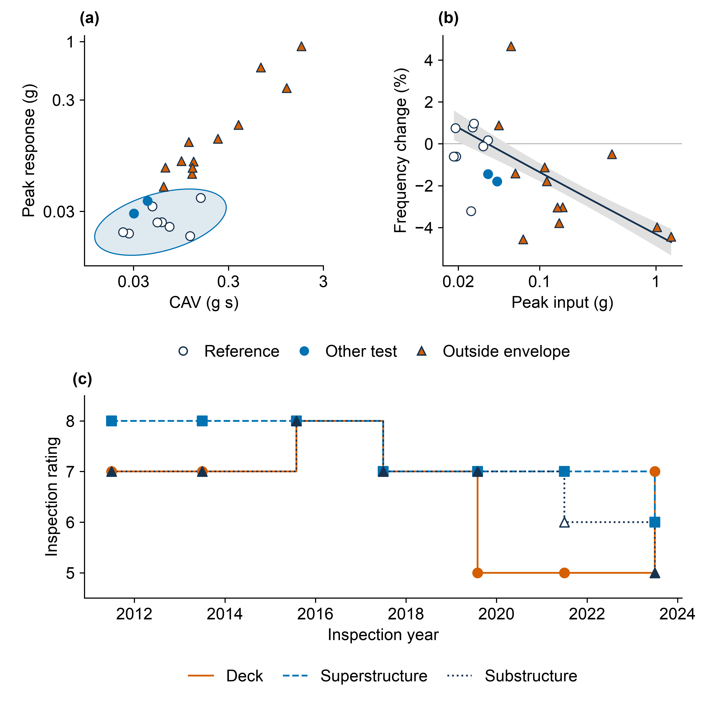

# Painter Street Overpass response analysis

Analysis of earthquake response at the Painter Street Overpass in Rio Dell, California (CESMD CE89324; Caltrans 4-236). The repository contains derived measurements from 22 earthquakes during 2012–2024, National Bridge Inventory inspection records, and Python code for response screening, frequency–amplitude analysis, and persistent-shift tests.

Twelve of 14 test events fall outside a nominal 95% response envelope fitted to the eight events with the smallest peak structural response. The tracked 3.38 Hz mode decreases by about 5.5% across the observed input-amplitude range. After amplitude adjustment, no persistent shift exceeds the Šidák or Bonferroni multiple-testing threshold. These results describe response variability; they do not establish earthquake damage or its absence.



**Figure 1.** (a) Peak response acceleration and cumulative absolute velocity, with the nominal reference envelope. (b) Frequency change versus input PGA; shading shows the approximate 95% coefficient interval, including covariance. Open circles identify reference events, blue circles other test events, and orange triangles events outside the envelope. (c) Inspection ratings; hollow symbols mark revisions at an unchanged inspection date. Lines connect inspection records and do not date physical changes.

## Run the analysis

Use Python 3.11:

```bash
python3.11 -m venv .venv
source .venv/bin/activate
python -m pip install -r requirements-lock.txt
python analysis.py
python -m unittest discover -s tests -v
```

The analysis runs offline from the supplied derived measurements, checks input checksums and saved numerical results, and writes tables to `results/` and figures to `figures/`. Waveform processing and modal identification are outside this package. See [METHODS.md](METHODS.md) for the analysis and its limitations, and [VERIFICATION.md](VERIFICATION.md) for reproduction checks.

## Sources and license

Strong-motion records are from [CESMD](https://doi.org/10.5066/P13HTZQS), provided by CGS/CSMIP through the Caltrans–CGS bridge instrumentation program. Inspection records are from the [FHWA National Bridge Inventory](https://www.fhwa.dot.gov/bridge/nbi/ascii.cfm). Response features follow [Muin, Chern, and Mosalam (2024)](https://doi.org/10.1061/JBENF2.BEENG-6587).

Code is licensed under MIT. Original documentation, figures, and derived tables are CC BY 4.0; source metadata retain their original terms. See [SOURCE_NOTICES.md](SOURCE_NOTICES.md).
